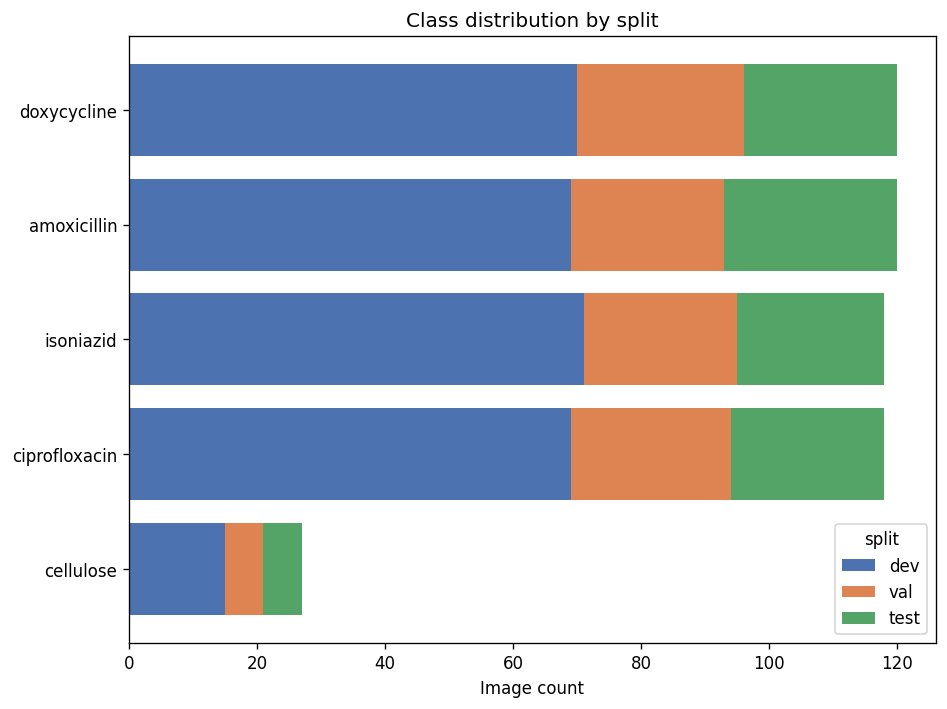
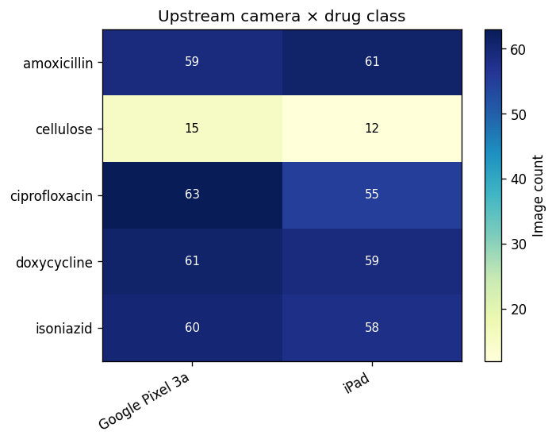

# `FHI360_Subset_PADFusion` Dataset — v3.0 (leak-free, card-grouped)

A 503-image subset of the FHI360 2020-2022 PAD card corpus (85 unique physical
cards), the CNN/NIR training data for the
[`PaperAnalyticalDeviceND/model_fusion`](https://github.com/PaperAnalyticalDeviceND/model_fusion)
PAD + NIR multimodal fusion project.

## What changed in v3.0

**v3.0 re-splits the data to be leak-free.** The split is now **grouped by physical
card (`sample_id`)** — every image of a card is in exactly one split — and
**jointly stratified by (drug x concentration)**: each (drug, concentration) cell
of 5 cards contributes **3 train / 1 val / 1 test** cards. This supersedes the v2.0
60/25/15 **per-image** split, in which ~91% of `sample_id`s appeared in more than
one split (a card's photos were spread across train/test/val), inflating any
model scored on it. See model_fusion Experiment 29 and the project's
Dataset-Splitting-Protocol (physical source = one split).

Two consequences for consumers:
- **No `sample_id` straddles splits** (verified: 0 of 85 cards).
- **Balanced per drug x concentration** — training a single-drug concentration
  model leaves every one of that drug's concentrations with cards in all three
  splits (v2.0's concentration-only stratification could leave a drug's
  concentration with zero val/test cards).

## Description

503 card images from 85 unique sample IDs covering four antibiotic APIs
(Amoxicillin, Ciprofloxacin, Doxycycline, Isoniazid) at four concentration
buckets (20%, 50%, 80%, 100%) plus a Cellulose 0%-API control. `quantity` carries
the raw upstream value; cellulose control rows are `quantity = 0`.

### Data Distribution

| Split | Images | Unique sample IDs |
|---|---:|---:|
| Development (train) | 294 | 51 |
| Validation | 105 | 17 |
| Test | 104 | 17 |
| **Total** | **503** | **85** |

Unlike v2.0 (whose `val` was the "categorize" held-out set), the v3.0 `val` split
is a true validation partition — every (drug, concentration) cell is exactly
3 train / 1 val / 1 test cards, and the three splits are disjoint by card.

#### Class Distribution

| class | #dev | #val | #test | #total |
|:------|-----:|-----:|------:|-------:|
| amoxicillin | 69 | 24 | 27 | 120 |
| cellulose | 15 | 6 | 6 | 27 |
| ciprofloxacin | 69 | 25 | 24 | 118 |
| doxycycline | 70 | 26 | 24 | 120 |
| isoniazid | 71 | 24 | 23 | 118 |

The class names `ciprofloxacin` and `isoniazid` are preserved from the upstream
FHI360 source CSVs (typographic variants); they refer to the same physical drugs.

#### Dataset Visualizations

**Class Distribution by Split**

**Upstream Camera x Drug**

## Provenance

Re-split from `FHI360_Subset_PADFusion_v2.0` by joining the original 8-column
metadata to a card-grouped, (drug x concentration)-stratified assignment
(3/1/1 per cell, seed 42). No image rows added or removed; only the split
column changed. Build logic mirrors `neural_network/PAD_quantity_prepare_data.py`
(`--split holdout1`) in the model_fusion repo.
